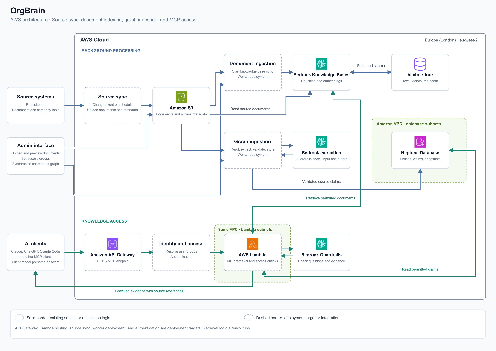
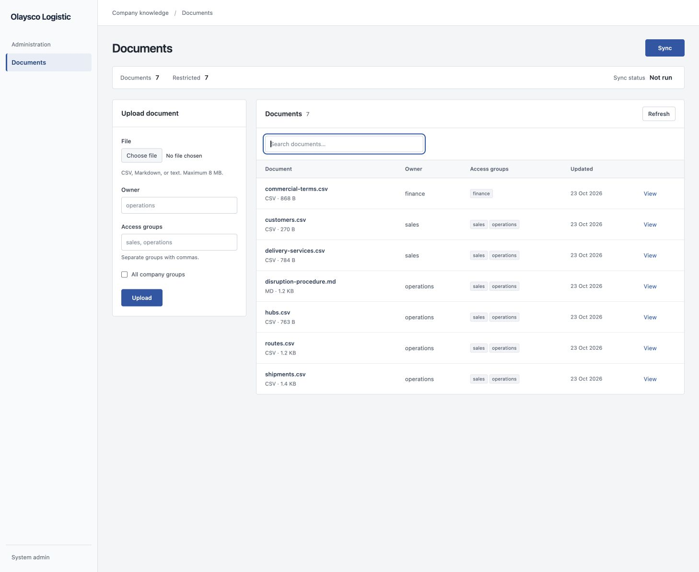
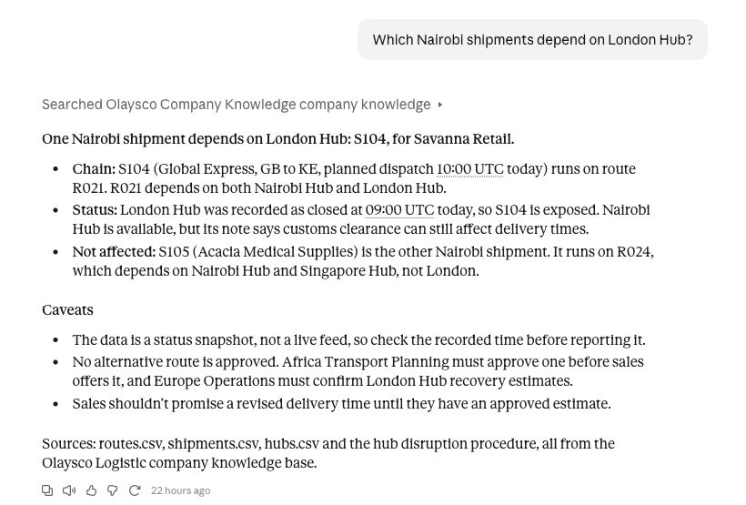

# OrgBrain

Give AI access to company knowledge while the company controls access permissions, content policies, and source evidence.

This system provides a shared knowledge layer between company data and AI applications.
It combines GraphRAG, authorization, and configurable Guardrails, then exposes permitted evidence through the Model Context Protocol (MCP).

## Beyond semantic search

Vector search works well for finding text that is similar in meaning to a question.
However, some questions require more than similar text.
They require connections between information held in different sources.
OrgBrain adds a knowledge graph to follow explicit relationships: what depends on what, who owns it, and which source supports each connection.
It combines these relationships with vector search to retrieve relevant text and connected evidence across a company’s knowledge sources.
Source quotes and references make that evidence traceable, although extracted relationships can contain errors and still require review.

Access to connected knowledge also requires control over what each user can retrieve.
OrgBrain applies group permissions to both document retrieval and graph evidence.
This is authorization: it controls access to information.
Authentication identifies the user; the current prototype uses a configured group until an identity provider is connected.

Access permissions alone do not determine whether content meets company policies.
OrgBrain also uses Guardrails during relationship extraction, before retrieval, and before the MCP service returns evidence.
These configurable policies can block sensitive information, including personal data.
They reduce exposure but do not guarantee detection of all sensitive content.
The MCP client generates the final answer outside these checks.

MCP makes this knowledge layer available to compatible AI applications through one interface.
A company can change its client model or chat interface while it retains its knowledge store, source evidence, and access rules.
The current ingestion and retrieval components use AWS services.

## Architecture

The admin interface uploads CSV, Markdown, or text files to S3 with access metadata.
Administrators can preview documents, assign access groups, and start synchronization from one screen.

Synchronization updates document search, then extracts relationships and stores validated claims in Neptune.
Extraction uses types and relationship names from the source data.
It does not require a fixed domain schema or a special CSV evidence column.

| Component | Function |
|---|---|
| S3 | Stores source documents and access metadata |
| Bedrock Knowledge Bases | Splits documents into chunks, creates embeddings, and retrieves relevant text |
| Vector store | Stores embeddings and supports similarity search through the Knowledge Base |
| Bedrock models | Extract relationships from source content |
| Neptune | Stores entities, claims, source quotes, and document snapshots |
| Bedrock Guardrails | Applies configurable content policies |
| Go MCP server | Combines permitted document and graph evidence |

Graph retrieval follows up to three relationship steps.
Results do not prove complete coverage or current source status.

Once the knowledge is available, a user can query it through Claude or another compatible MCP client.
Here, Claude follows a shipment dependency through route and hub records, then returns an answer with source references.

## Validation

Focused automated tests cover access filters, blocked input, blocked output, graph traversal, source identifiers, and admin upload and synchronization.
The tests use simulated AWS responses; the Claude screenshot shows a recorded integration result.
See the [verification commands](docs/setup.md#verification) for the focused checks.

## Run locally

Use Go 1.25.1 or later and existing AWS resources.
Follow the [setup guide](docs/setup.md) to configure AWS access and start the servers.

The MCP server provides the read-only `search_company_knowledge` tool.
The current implementation runs locally against AWS services; the diagram also includes deployment targets.
This repository does not create AWS resources.

Run `go test ./...` to execute the tests.

## Future

The next steps extend source coverage and deployment options.

- [ ] Add user authentication and access groups from a company identity provider.
- [ ] Add connectors for company documents and code repositories.
- [ ] Add scheduled synchronization.
- [ ] Deploy the MCP server through API Gateway and Lambda.
- [ ] Extend content checks to final answers in applications that control answer generation.
- [ ] Make graph traversal depth and request limits configurable.
- [ ] Track source changes and document status during retrieval.
- [ ] Add user feedback to support reviewed knowledge updates.
